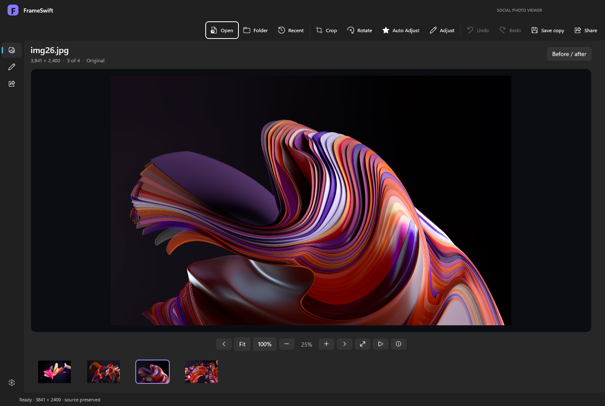
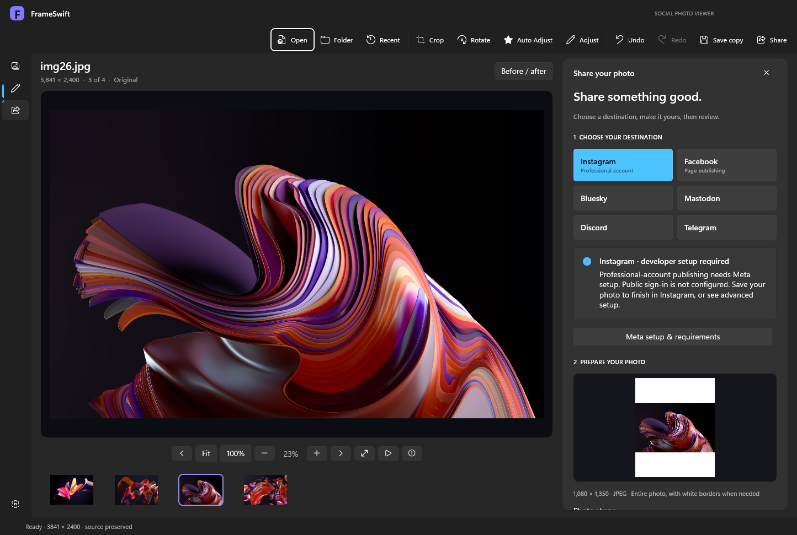

# FrameSwift Social Photo Viewer

A free native Windows photo viewer by **Prosper Technologies**. View your photos, crop and adjust them, and prepare them for sharing in one app.

**[Visit the website](https://ProsperTechnology.github.io/frameswift/)** · **[Download for Windows](https://github.com/ProsperTechnology/frameswift/releases/tag/v1.2.1)**

**View. Fine-tune. Share.** A photo-first workspace for your Windows desktop.

| View | Edit | Share |
| --- | --- | --- |
| Folder browsing and thumbnails | Freeform and preset crops | Bluesky and Mastodon |
| Fit, 100%, zoom, and pan | Auto Adjust and image adjustments | Discord channel webhooks |
| Fullscreen and slideshow | Before/after and undo/redo | Telegram bots |
| Light/dark appearance | Full-resolution JPEG/PNG copies | Review before publishing |

## Preview 1.2.1

**New: X.com sharing.** Save a prepared photo and open X with the caption prefilled, then attach the photo and post on X. The prepared direct API adapter requires developer setup; public X sign-in is not configured.

New sharing workspace: destination tiles, framing preview, caption counts, account status, image descriptions, disconnect, and final review. Switching platforms preserves your caption draft.

- Fullscreen viewing, folder browsing, thumbnails, zoom, pan, and slideshow.
- Crop presets, rotation, flip, Auto Adjust, exposure, color, and sharpening.
- Before/after, undo/redo, and full-resolution PNG/JPEG copies.
- First-launch default-viewer prompt, saved preferences, and edit recovery.
- Direct sharing integrations for Bluesky, Mastodon, Discord webhooks, and Telegram bots. Live account publishing still requires broader verification.

Windows 10 version 2004 or later, x64. Windows 11 is the primary test platform. This preview installer is unsigned. Optional formats depend on Windows codecs. GIF/TIFF display the first frame/page.

## Get started

1. Download the x64 installer from the release page.
2. Run setup, then open FrameSwift from Start or the desktop shortcut.
3. Open a photo or folder. Choose **Make default** when prompted if you want to select FrameSwift in Windows Default apps.
4. Use **Save copy** after editing to keep your source photo unchanged.

### Know what is included

The current build is an early preview. Live social publishing still needs broader verification. Instagram and Facebook now have destination tiles, prepared developer API adapters, and a save-photo/open-website handoff. Public Meta sign-in is not configured. Facebook API publishing targets Pages; Instagram requires a professional account linked to a Page and a hosted prepared JPEG. See [Meta setup](docs/meta-setup.txt). X.com now has a caption-prefilled browser handoff and a prepared direct-publishing adapter. Public X sign-in is not configured. See [X setup](docs/x-setup.txt). Other social networks remain unconnected. RAW, SVG, animated playback, and multipage navigation are not included. See the release notes for complete limits.

Photos stay on your PC until you approve a social publication. FrameSwift has no analytics, ads, or cloud account. Social connections stay in memory and clear on exit.

## Download verification

Download the installer and matching SHA-256 file from [Releases](https://github.com/ProsperTechnology/frameswift/releases). Release notes describe current capabilities and limits.

## Website

The static GitHub Pages website lives in `docs/` and deploys from `main`. It uses no build tools, external fonts, analytics, or third-party scripts. App source is not included in this repository.

## Feedback

Use [Issues](https://github.com/ProsperTechnology/frameswift/issues) for bug reports and suggestions. Include your Windows version, app version, and steps to reproduce. Never attach passwords, tokens, or private photos.

Copyright 2026 Prosper Technologies. All rights reserved. The app is free to use; this is not an open-source license. Third-party notices are included with the installer.

